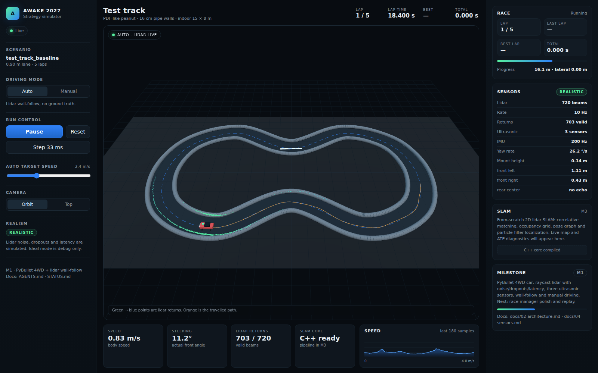

# AWAKE Challenge 2027 — Autonomous Car Simulator

A physically credible 3D simulator and strategy lab for the AWAKE Challenge 2027
mini autonomous vehicle: realistic non-ideal sensors, from-scratch 2D lidar SLAM,
and a browser dashboard for live monitoring, replay and experiments.

> Status: **M1 complete**. PyBullet 4WD car, non-ideal lidar/ultrasonic stack,
> wall-follow and manual driving are live; 5 autonomous laps completed in
> 148.34 s. See [`STATUS.md`](STATUS.md) for the live state and `docs/devlog/`
> for progress.



## Why this exists

The competition car must complete five consecutive laps of an unknown indoor track
as fast as possible, using a lidar, at least three ultrasonic sensors, an IMU and
wheel odometry. This project lets the team:

- compare control and planning strategies before touching the real car;
- see how sensor imperfections (noise, dropouts, latency, motion distortion)
  change lap times and SLAM quality;
- develop a SLAM pipeline that can later be ported to the Raspberry Pi;
- generate many track variants so the strategy does not overfit the training
  circuit;
- monitor every run through a browser dashboard, with replay and batch comparison.

## Planned features

| Area | Features |
|---|---|
| Simulation | PyBullet 3D, generic 1/10 4WD Ackermann car, fixed 240 Hz physics, track walls and obstacles |
| Sensors | LD06-class 2D lidar, 3 ultrasonic, IMU, encoders, steering sensor; non-ideal by default |
| SLAM | C++17 CSM + ICP, occupancy grid, pose graph/loop closure, MCL localization; live diagnostics |
| Strategies | Wall-follow, gap-follow, pure pursuit, Stanley, MPC, racing line, time-optimal speed profile |
| Experiments | Seeded batch runs, lap-time/robustness metrics, SQLite/CSV, leaderboard, Pareto plots |
| Dashboard | Live 3D, sensor views, charts, replay, experiment comparison, live tuning, track editor |
| Docs | `AGENTS.md`, `STATUS.md`, architecture, requirements traceability, devlog, ADRs, runbook |

## Documentation

Start here:

- [`AGENTS.md`](AGENTS.md) — rules for working in this repo.
- [`STATUS.md`](STATUS.md) — current state and how to run it.
- [`docs/README.md`](docs/README.md) — documentation index.
- [`docs/02-architecture.md`](docs/02-architecture.md) — system architecture.
- [`docs/04-sensors.md`](docs/04-sensors.md) — non-ideal sensor models.
- [`docs/06-slam.md`](docs/06-slam.md) — SLAM design.

## Quick start

```bash
# toolchain (one-time)
sudo apt install -y build-essential cmake ninja-build libeigen3-dev

# Python 3.11 + dependencies
uv sync --all-extras

# backend
uv run uvicorn awake_sim.server.app:app --reload --port 8000

# dashboard (second terminal)
cd web
npm install
npm run dev
```

Open the dashboard at the URL printed by Vite (usually `http://localhost:5173`).

## Competition context

The source specification is `Cahier des charges 2027.pdf` (AWAKE Group). Key
constraints: 1/10 scale, ≤45 × 20 × 20 cm, electric, 4WD recommended, ≥5 mm ground
clearance, at least three ultrasonic sensors plus a lidar, GPS forbidden, indoor
track 15 × 8 m with 80–100 cm lanes and 16 cm high pipe walls, five consecutive
laps, penalties for wall deformation and interventions. See
[`docs/01-requirements.md`](docs/01-requirements.md) for the traceable list.

## License / use

Internal team project for the AWAKE Challenge 2027. The competition specification
remains the property of AWAKE Group.
