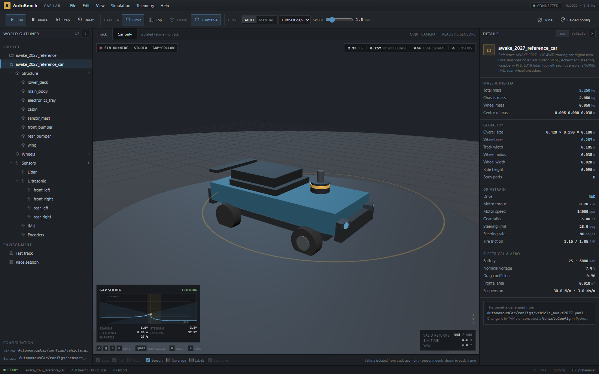

# AWAKE 2027 — simulator core & car lab

A physically credible standalone simulator and browser car lab for the AWAKE
Challenge 2027 mini autonomous vehicle. The default physics backend is a
MuJoCo digital twin; the original PyBullet backend remains available for
comparison. Both share one vehicle definition, one sensor-only controller
boundary and the same dashboard.



Reference hardware and calibration:
[hardware BOM](docs/10-hardware.md) · [calibration protocol](docs/11-calibration.md) ·
[car definition](docs/09-car-definition.md) · [dashboard](docs/08-dashboard.md).

The core remains deliberately small: **no SLAM, MCL, occupancy grid, racing line
or telemetry cloud**. The dashboard is a local renderer and operator console for
the simulator.

## 1. Architecture

```text
Browser (React + Three.js)
    │  REST + WebSocket (JSON)
FastAPI dashboard (dashboard/)
    │
Simulation core (simulator/, 240 Hz physics, 60 Hz control)
    ├── generated URDF/MJCF from the vehicle config
    ├── MuJoCo digital twin (default) and PyBullet backend
    ├── track, car, sensors and timing
    └── non-ideal lidar, ultrasonic and drifting odometry
Algorithms (algorithms/)
    └── Observation -> Actuation controllers (NumPy only)
```

- `simulator/` owns physics, sensor models, latency, the track and lap timing.
- `dashboard/` owns the browser UI, telemetry transport and car inspection view.
- `algorithms/` owns the driving policy and imports **only**
  `algorithms.interface` and NumPy.
- `Observation` has no true pose and no future scan. The only pose is drifting
  wheel/IMU odometry.
- The dashboard may show ground truth for debugging; controllers never receive it.
- A real serial/CAN adapter can implement `RobotAPI` and run the same controllers.

### Folder layout

```text
simulator/
  config.py                 pydantic config models + YAML loading
  car_urdf.py               generates the URDF from VehicleConfig
  mjcf.py                   generates the MuJoCo MJCF digital twin
  track.py                  peanut track, walls and obstacles
  vehicle.py                VehicleState / Actuation
  world.py                  PyBullet world and raycasts
  mujoco_world.py           MuJoCo world and raycasts
  transforms.py             body/sensor rotation helpers
  odometry.py               drifting wheel/IMU odometry
  sensors/                  non-ideal lidar and ultrasonic models
  simulation.py             fixed-step loop, latency filtering, lap timing
  cli.py                    headless runner
  configs/                  scenario, vehicle and sensor YAML
  assets/                   reference URDF only
algorithms/
  interface.py              Observation, Actuation, Controller, RobotAPI
  gap_follow.py             lidar-only demo controller
  wall_follow.py            lidar-only demo controller
  template.py               safe stop placeholder
dashboard/
  server.py                 FastAPI REST + WebSocket adapter
  spec.py                   car, sensor and track JSON payloads
  web/                      React/Three.js dashboard
examples/
  custom_car.py             fully code-defined car example
docs/
 10-hardware.md             reference BOM and wiring
 11-calibration.md          measurement and validation protocol
tests/
```

## 2. Quick start

```bash
uv sync --extra dev

# backend (terminal 1)
uv run python -m dashboard.server

# frontend (terminal 2)
cd dashboard/web
npm install
npm run dev
```

Open the Vite URL (usually `http://localhost:5173`). The API runs on
`http://localhost:8000`. A production build is served by the backend after
`npm run build`. The dashboard defaults to the reference car in
`simulator/configs/awake_2027.yaml` and the MuJoCo backend.

Headless simulator:

```bash
# MuJoCo digital twin (default)
uv run python -m simulator.cli --laps 1 --max-time 5
uv run python -m simulator.cli \
  --controller algorithms.gap_follow:FurthestGapController \
  --laps 1 --realism ideal --lidar-subrays 1

# compare against the PyBullet backend
uv run python -m simulator.cli --backend pybullet --laps 1 --max-time 5
```

Switch the dashboard backend with `AWAKE_BACKEND=pybullet`, and the scenario with
`AWAKE_SCENARIO=/path/to/scenario.yaml`.

## 3. The car is data

There is **one** vehicle definition. It generates the URDF/MJCF that the physics
backends load and the geometry that the dashboard draws. There is no second
hand-written car model.

`simulator/configs/vehicle_awake2027.yaml` defines the reference competition car;
`simulator/configs/vehicle.yaml` remains the generic example. Both define:

- mass, centre of mass and competition limits;
- chassis `structure` parts (box / cylinder / sphere, visual and/or collidable);
- wheelbase, track width, wheel radius, width, mass and vertical offset;
- drive layout, motor, battery, tires, suspension, aero and steering limits.

Example body part:

```yaml
structure:
  - name: main_body
    shape: box
    position_m: [0.0, 0.0, 0.005]
    size_m: [0.38, 0.18, 0.055]
    color: "#a53235"
    collision: true
```

Positions are in the vehicle body frame: **x forward, y left, z up**, origin at
the chassis centre. For a cylinder, `size_m` is `[diameter, diameter, height]`;
for a sphere it is `[diameter, diameter, diameter]`.

Sensor positions and rotations live in `simulator/configs/sensors.yaml` and use
the same body frame:

```yaml
lidar:
  mount:
    position_m: [0.10, 0.0, 0.05]
    rpy_deg: [0.0, 0.0, 0.0]
  beams: 720
  max_range_m: 12.0
  noise:
    range_sigma_m: 0.012
```

Other sensors follow the same pattern. IMU, encoder and lidar/ultrasonic
characteristics are all parsed and used by the sensor models.

### Build a car in code

```python
from simulator.config import BodyPart, load_sensors, load_vehicle
from simulator.simulation import Simulation

vehicle = load_vehicle("simulator/configs/vehicle.yaml")
sensors = load_sensors("simulator/configs/sensors.yaml")

vehicle.mass_kg = 2.35
vehicle.wheelbase_m = 0.27
vehicle.tires.friction_rear = 1.15
vehicle.structure.append(
    BodyPart(
        name="sensor_pod",
        shape="cylinder",
        position_m=(0.0, 0.0, 0.07),
        size_m=(0.04, 0.04, 0.02),
        color="#d9dde1",
        collision=False,
    )
)
sensors.lidar.beams = 540
sensors.lidar.mount.position_m = (0.105, 0.0, 0.06)

simulation = Simulation(vehicle=vehicle, sensors=sensors, lidar_subrays=1)
```

See [`examples/custom_car.py`](examples/custom_car.py) for a runnable example:

```bash
uv run python -m examples.custom_car
```

Download the generated physics models from the running dashboard:

```bash
curl -o car.urdf http://localhost:8000/api/car/urdf
curl -o car.xml  http://localhost:8000/api/car/mjcf
```

## 4. Dashboard

### Track view

Live MuJoCo/PyBullet scene with the car, walls, obstacles, lidar returns, path trail and
odometry trail. Drive manually with `Z/Q/S/D` or use the two lidar-only demo
controllers.

### Car studio

Click **Car only** or press `C`. The studio renders the vehicle in isolation:
no track surface, walls, obstacles, lidar returns or trails. It shows the body
parts, wheels, sensor mounts and optional sensor coverage directly from the same
configuration that drives physics.

Useful controls:

- `Space` — run / pause
- `R` — reset
- `C` — track / car studio
- `1` / `2` / `3` — orbit / top / chase camera
- `T` — car studio turntable
- `Z/Q/S/D` — manual drive (WASD also works)

### Tuning console

Click **Tune** in the toolbar or details panel. The modal edits the raw vehicle
and sensor configs, including:

- mass, dimensions, structure parts, wheels, motor, battery, tires, suspension,
  aero and steering;
- all lidar/ultrasonic/IMU/encoder fields and body-frame mounts;
- steering `rate_deg_s` (the servo slew-rate limit), latency, deadband and max
  angle in the quick-tune strip.

Use **Apply live** to rebuild without touching disk, or **Apply & save YAML** to
persist the values in `vehicle_awake2027.yaml` / `sensors_awake2027.yaml`.
`Ctrl+Z` / `Ctrl+Y` undo and redo draft edits; `Esc` closes the console.

### Random track generator

Click **Test track** (or **Random track**) in the outliner. The details panel
exposes a seed, lane width and **object density** (0 = empty, 1 = maximum
crates/poles). Generated tracks stay inside the 15 × 8 m arena. The **Default**
button always restores the reference test track.

### Gap-solver debug

When the gap-follow controller is active, the viewport shows:

- the chosen gap and opening fan in 3D;
- a live clearance-vs-bearing profile;
- bearing, steering, clearance, opening and throttle values.

Use the **Gap solver** layer toggle to hide or show the debug overlay.

After editing YAML, click **Reload config**. The backend rebuilds the URDF/MJCF
and simulation and pushes a fresh `hello` message to the browser.

### REST and WebSocket

- `GET /api/health`, `/api/status`, `/api/car`, `/api/car/urdf`, `/api/car/mjcf`, `/api/track`, `/api/config`
- `WS /ws/telemetry` — hello, state and scan messages; commands include
  `run.start`, `run.pause`, `run.reset`, `run.step`, `run.set_speed`,
  `control.mode`, `control.controller`, `drive.command`, `config.reload`,
  `config.apply`, `track.generate`, `track.default`.

## 5. Add an algorithm

1. Create `algorithms/my_controller.py`.
2. Implement `reset()` and `update(observation)`.
3. Return an `Actuation`.
4. Run it with `--controller algorithms.my_controller:MyController`.

Minimal example:

```python
from algorithms.interface import Actuation, Observation


class MyController:
    def reset(self) -> None:
        self.steering = 0.0

    def update(self, observation: Observation) -> Actuation:
        scan = observation.lidar
        if scan is None:
            return Actuation(throttle=0.0, steering=self.steering)

        import numpy as np

        front = np.abs(scan.angles_rad) < np.deg2rad(60.0)
        valid = front & scan.valid & np.isfinite(scan.ranges_m)
        if not np.any(valid):
            return Actuation(throttle=0.0, steering=self.steering)

        ranges = np.where(valid, scan.ranges_m, -1.0)
        best = int(np.argmax(ranges))
        target = float(scan.angles_rad[best])
        self.steering += 0.25 * (target - self.steering)
        return Actuation(throttle=0.35, steering=self.steering)
```

Contract rules:

- Handle `observation.lidar is None`: the first scan may still be in flight.
- Only use data whose `t_available` is in the past.
- `observation.odometry` is the only pose. It drifts on purpose.
- Units are SI: metres, seconds, radians, m/s, rad/s.
- Keep controllers deterministic for a fixed observation sequence.
- Do not import `simulator.*` from `algorithms/*`.
- `throttle` is `-1..1`; `steering` is radians, positive left.

## 6. Sensors

- Lidar: 720 beams by default, range/angle noise, quantization, per-beam
  timestamps, motion distortion, divergence/mixed pixels, incidence dropout,
  dead beams, dropped scans, intensity, wall-height occlusion, mount RPY,
  latency/jitter and calibration offset. Rays are traced in 3D so a tilted mount
  changes what is measured.
- Ultrasonic: cone integration, blind zone, max range, range noise, low update
  rate, latency, cross-talk, specular dropouts and missed thin objects.
- Odometry: scale errors, bias, random walk and noise. Encoder characteristics
  are part of the sensor config.
- Realism presets: `ideal`, `realistic`, `harsh`; `realistic` is the default.

## 7. Tests and checks

```bash
uv run pytest
uv run ruff check simulator algorithms dashboard tests examples
uv run mypy simulator algorithms dashboard
cd dashboard/web && npm run build
```

The tests cover the sensor-only boundary, lidar/ultrasonic latency, deterministic
reset, configuration limits, generated URDF geometry and dashboard payloads.

## 8. Raspberry Pi transfer

Copy the deployable folders:

```bash
scp -r simulator algorithms pi@raspberrypi.local:~/
```

On the Pi:

```bash
cd ~
python3 -m venv .venv
. .venv/bin/activate
pip install numpy pydantic pyyaml pybullet

python -m simulator.cli --laps 1 --max-time 5 --lidar-subrays 1
python -m simulator.cli \
  --controller algorithms.gap_follow:FurthestGapController \
  --laps 5 --lidar-subrays 1
```

The algorithm contract only needs NumPy. MuJoCo and PyBullet are simulation
dependencies; the real car only needs a `RobotAPI` adapter. PyBullet on a Pi is
optional and needs a working OpenGL/EGL setup. On the real car, implement
`RobotAPI` with your serial/CAN adapter.

## 9. Configuration

`simulator/configs/scenario.yaml` references `vehicle.yaml` and `sensors.yaml`
relative to itself:

```yaml
vehicle: vehicle.yaml
sensors: sensors.yaml
seed: 42
realism: realistic
race:
  laps: 5
simulation:
  physics_hz: 240
  control_hz: 60
  max_time_s: 240
```

The simulator uses a fixed physics timestep, seeded sensor RNG streams and a
fixed control period. Rendering never affects results.
