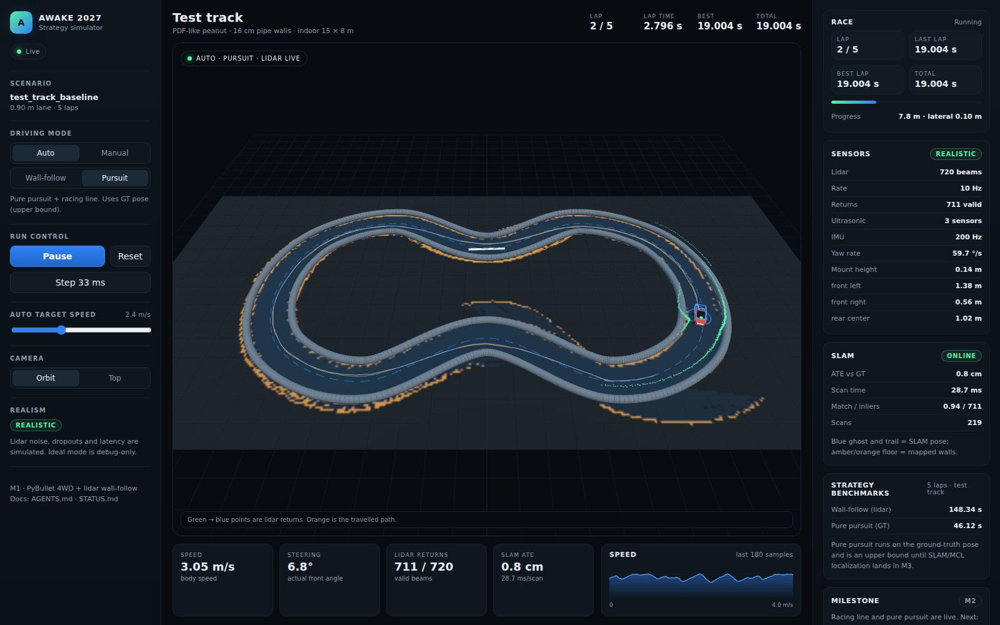

# Project status

> Last updated: 2026-10-30
> Current milestone: **M3 in progress — SLAM front-end live**



## Headline results

Test track, 5 laps, `realistic` sensors:

| Controller | Total (s) | Best lap (s) | Localization |
|---|---:|---:|---|
| Wall-follow (lidar) | 148.34 | 29.46 | lidar only |
| **Pure pursuit + racing line** | **46.12** | **9.20** | ground truth (upper bound) |

SLAM front-end (`slam-bench`, 8 s / 81 scans):

| Metric | Result |
|---|---:|
| ATE mean | **2.89 cm** |
| ATE max | 5.27 cm |
| Scan time mean | **14.2 ms** |
| Scan time p95 | **18.9 ms** |
| Occupied / free cells | 2,255 / 9,179 |

The live dashboard screenshot shows the SLAM occupancy map, blue SLAM ghost
pose/trail, **0.8 cm ATE**, and 28.7 ms/scan under telemetry load.

## What works today

- PyBullet 1/10 4WD Ackermann car, 240 Hz physics, 16 cm pipe walls.
- 720-beam non-ideal lidar: noise, quantization, motion distortion, dropouts,
  dead beams, intensity, wall-height occlusion and latency.
- Three non-ideal ultrasonic sensors; IMU/odometry hooks.
- Latency-aware control: the last command is held while a scan is in flight.
- Wall-follow (lidar only), manual WASD driving.
- Racing line + time-optimal speed profile; pure pursuit (GT upper bound).
- Race manager: 5-lap timing, start-line arming, progress/lateral offset.
- **C++17 SLAM front-end**: per-beam deskew, occupancy grid, chamfer likelihood,
  coarse/fine correlative matching with motion prior, pybind11 bindings.
- Live SLAM visualization: occupancy map texture, SLAM ghost/trail, ATE and
  scan-time diagnostics.
- Dashboard: live 3D, lidar, sonars, steering, speed trace, strategy benchmarks,
  controller switch, auto/manual, target speed, camera modes.
- CLI: `awake-sim race`, `compare`, `slam-bench`.
- 24 Python tests + C++ CTest green; ruff/mypy clean; frontend builds.

## Milestone status

- **M0 ✅** — bootstrap, docs, dashboard, C++ binding.
- **M1 ✅** — 5 autonomous wall-follow laps, realistic sensors.
- **M2 core ✅** — racing line, pure pursuit, strategy benchmark; generator,
  batch matrix, replay and editor still pending.
- **M3 front-end ✅** — C++ SLAM tracking + live map; pose graph/loop closure,
  MCL, drift tests and real-log replay pending.

## Next tasks

1. M3b: drifting-odometry test, SE(2) pose graph, loop closure, MCL/global
   relocalization, map IoU and ATE/RPE reporting.
2. M2 rest: seeded track generator with obstacles, batch matrix runner, replay,
   live tuning and track editor.
3. Calibration against the real car when hardware is chosen.
4. Pi port and benchmark (deferred).

## Known issues

- SLAM has no loop closure or MCL yet; odometry is GT + noise, not a drifting
  wheel odometry.
- Some map artefacts appear outside the lane at high speed; robust map updates
  are planned.
- Pure pursuit uses ground truth; the deployable result needs SLAM/MCL pose.
- Live mode uses one lidar sub-ray per beam; batch high-fidelity uses three.
- No replay, batch matrix or track editor yet.
- Wall-follow is conservative and slow on the waist corners.

## How to run

```bash
uv run uvicorn awake_sim.server.app:app --port 8000
cd web && npm run dev -- --port 5173
# open http://localhost:5173
```

Headless checks and benchmarks:

```bash
uv run awake-sim compare --laps 5
uv run awake-sim slam-bench --duration 20
uv run pytest -q
uv run python -m awake_sim.cli test-cpp
```

## Monitoring

- Devlog: [`docs/devlog/2026-10-30.md`](docs/devlog/2026-10-30.md)
- Experiments: [`docs/experiments/EXP-0001`](docs/experiments/EXP-0001-strategy-baseline.md),
  [`EXP-0002`](docs/experiments/EXP-0002-slam-frontend.md)
- Architecture: [`docs/02-architecture.md`](docs/02-architecture.md)
- SLAM: [`docs/06-slam.md`](docs/06-slam.md)
- Sensors: [`docs/04-sensors.md`](docs/04-sensors.md)
- Roadmap: [`docs/11-roadmap.md`](docs/11-roadmap.md)
