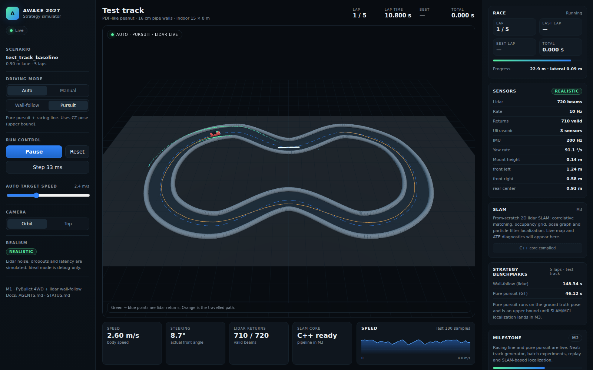

# Project status

> Last updated: 2026-10-30
> Current milestone: **M2 in progress — racing line + pure pursuit working**



## Headline result

5 laps on the test track with `realistic` sensors:

| Controller | Total (s) | Best lap (s) | Localization |
|---|---:|---:|---|
| Wall-follow (lidar) | 148.34 | 29.46 | lidar only |
| **Pure pursuit + racing line** | **46.12** | **9.20** | ground truth (upper bound) |

Pure pursuit is **3.22× faster** than wall-follow. It is not yet deployable
because it uses the ground-truth pose; SLAM/MCL localization is the M3 task.
Full report: [`docs/experiments/EXP-0001-strategy-baseline.md`](docs/experiments/EXP-0001-strategy-baseline.md).

## What works today

- PyBullet 1/10 4WD Ackermann car, 240 Hz physics, 16 cm pipe walls.
- 720-beam non-ideal lidar: noise, quantization, motion distortion, dropouts,
  dead beams, intensity, wall-height occlusion, latency.
- Three non-ideal ultrasonic sensors, IMU/odometry hooks.
- Latency-aware control: the last command is held while a scan is in flight.
- Wall-follow (lidar only) and manual WASD driving.
- Racing line generation (corner cutting inside the lane) + time-optimal speed
  profile with lateral/acceleration/braking limits.
- Pure pursuit controller (ground-truth pose upper bound).
- Race manager: 5-lap timing, start-line arming, progress/lateral offset.
- Dashboard: live 3D, lidar, sonars, steering, speed trace, strategy benchmarks,
  controller switch, auto/manual, speed and camera controls.
- CLI: `awake-sim race` and `awake-sim compare`.
- 22 Python tests + C++ CTest green; ruff/mypy clean; frontend builds.

## M1 acceptance (still valid)

Five autonomous wall-follow laps with realistic sensors: 29.52, 29.89, 29.68,
29.46, 29.79 s; total 148.34 s; zero penalties.

## Next tasks (rest of M2)

1. Seeded track generator with obstacles and a simple editor.
2. Batch matrix runner (controllers × tracks × seeds) with SQLite/CSV results.
3. Full replay/scrubbing and run recordings.
4. Live tuning sliders for lookahead, speed scale and friction.
5. Minimum-curvature racing line refinement vs the heuristic line.

## Known issues

- Pure pursuit uses ground truth; not a deployable competition result yet.
- No obstacle generator/editor, batch matrix or replay yet.
- Live mode uses one lidar sub-ray per beam; batch high-fidelity uses three.
- SLAM is still the C++ binding skeleton; algorithms start in M3.
- Wall-follow is conservative and slow on the waist corners.

## How to run

```bash
uv run uvicorn awake_sim.server.app:app --port 8000
cd web && npm run dev -- --port 5173
# then open http://localhost:5173
```

Headless comparison:

```bash
uv run awake-sim compare --laps 5
```

## Monitoring

- Devlog: [`docs/devlog/2026-10-30.md`](docs/devlog/2026-10-30.md)
- Experiment: [`docs/experiments/EXP-0001-strategy-baseline.md`](docs/experiments/EXP-0001-strategy-baseline.md)
- Architecture: [`docs/02-architecture.md`](docs/02-architecture.md)
- Sensors: [`docs/04-sensors.md`](docs/04-sensors.md)
- Roadmap: [`docs/11-roadmap.md`](docs/11-roadmap.md)
