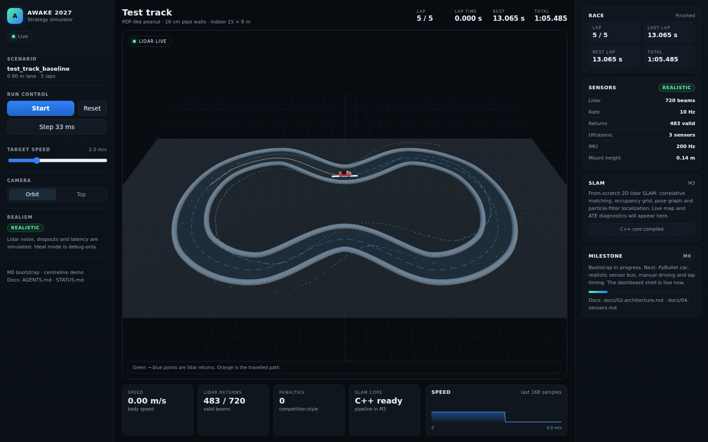

# Project status

> Last updated: 2026-10-30
> Current milestone: **M0 complete — M1 next**



## What works today

- Repository initialized with git; docs, ADRs, devlog and roadmap in place.
- Python 3.11 environment via `uv`, PyBullet and scientific stack installed.
- C++17 SLAM binding skeleton builds with CMake/Ninja and passes CTest.
- FastAPI backend with health/status/track endpoints and a live WebSocket.
- React + Three.js dashboard:
  - 3D peanut track with 16 cm pipe walls;
  - live car pose, 720-beam lidar returns and travelled path;
  - start/pause/reset/step and target-speed controls;
  - orbit/top cameras, race metrics, sensor panel, speed chart;
  - realism badge and lidar return count.
- M0 demo simulation: centreline follower, 5-lap timing, realistic-ish lidar
  noise/dropouts, auto-start.
- 15 Python tests + C++ test pass; `ruff` and `mypy` clean; frontend builds.

## How to run

```bash
# backend (WSL)
uv run uvicorn awake_sim.server.app:app --port 8000

# dashboard (second terminal)
cd web
npm run dev -- --port 5173
```

Open `http://localhost:5173`.

## Next tasks

1. Replace the demo with PyBullet: generic 1/10 4WD Ackermann car, suspension,
   tire friction and motor model.
2. Implement the latency-aware sensor bus and the full non-ideal lidar /
   ultrasonic / IMU / encoder models.
3. Add manual driving, a simple auto controller, collision detection, penalties
   and a proper race manager.
4. Add replay basics and sensor-health diagnostics.

## Known issues

- The current drive is a centreline demo, not physics.
- The C++ SLAM core is a binding skeleton; algorithms start in M3.
- Lidar is sampled from wall points, not raycast; occlusion is approximate.
- The lap timer shows 0 at race finish; it will be corrected with the race manager.
- Vite uses polling because inotify is unreliable on `/mnt/c` under WSL2.

## Monitoring

- Devlog: [`docs/devlog/2026-10-30.md`](docs/devlog/2026-10-30.md)
- Architecture: [`docs/02-architecture.md`](docs/02-architecture.md)
- Sensor model: [`docs/04-sensors.md`](docs/04-sensors.md)
- Roadmap: [`docs/11-roadmap.md`](docs/11-roadmap.md)
- Screenshot: [`docs/assets/2026-10-30-m0-dashboard.png`](docs/assets/2026-10-30-m0-dashboard.png)
