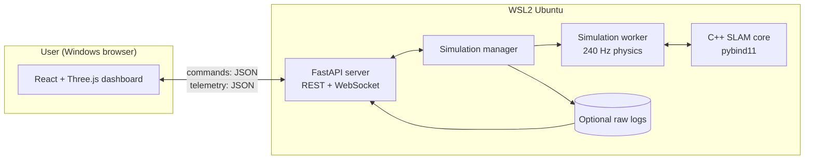

# Architecture

## 1. Design goals

- A **real-time 3D simulation** with credible vehicle dynamics and sensor physics.
- A **strategy lab** that can run headless races and controller comparisons.
- A **SLAM workbench** where every stage is inspectable and measurable.
- A **human-usable dashboard** for live monitoring and strategy comparison.
- A **portable core** so the SLAM and controllers can later run on the car.

## 2. System context



The browser is a **view and control client**. It does not run physics or SLAM.
This keeps results reproducible and lets the same simulation run headless for
`race` / `compare` / `slam-bench`.

## 3. Components

### 3.1 Python simulation package (`src/awake_sim/`)

| Module | Responsibility |
|---|---|
| `config/` | Pydantic models for vehicle, sensors, track, scenario, race |
| `sim/` | PyBullet world, fixed-step loop, vehicle, timing, sensor bus |
| `sensors/` | Lidar, ultrasonic, IMU, encoder and steering models |
| `tracks/` | PDF-like test track, procedural generator, editor serialization |
| `control/` | Controllers, racing line, speed profile, state estimation interface |
| `slam/` | Python bindings, reference implementation, evaluation, map export |
| `experiments/` | Experiment report helpers and metrics |
| `server/` | FastAPI app, WebSocket protocol, simulation manager |
| `cli/` | `awake-sim` commands (run, race, compare, slam-bench, build-cpp, test-cpp) |

### 3.2 C++ core (`cpp/`)

- `awake_slam::OccupancyGrid` — log-odds grid, Bresenham, chamfer likelihood.
- `awake_slam::SlamCore` — deskew, coarse/fine correlative matching, map update,
  keyframes, pose graph and local MCL.
- Reliable loop-closure detection and global MCL relocalization — pending.

Bindings are exposed through `src/awake_sim/_awake_slam*.so` and imported by
`awake_sim.slam`. A pure-Python reference implementation is kept for tests and
teaching; the real-time path is C++.

### 3.3 Dashboard (`web/`)

- React + TypeScript + Vite.
- Three.js for the 3D scene; a lightweight SVG speed trace.
- React state for run state.
- Views: Race, Engineering, Strategy, Project.
- WebSocket telemetry plus REST for status/config.

### 3.4 Storage

- Markdown experiment reports and plots in `docs/experiments/`.
- Optional raw logs under `data/` (gitignored).
- Config YAML + seed recorded with every reported run.

## 4. Runtime data flow

```text
fixed step 1/240 s
  ├── vehicle physics + track collisions
  ├── sensor sampling (rates below)
  │     lidar 10 Hz · ultrasonic 20 Hz · IMU 200 Hz · encoders 50 Hz
  ├── sensor bus: timestamp, latency, drops
  ├── controllers at 50 Hz read only available messages
  ├── SLAM at 10 Hz processes latest scan + odometry
  ├── race manager: start line, laps, penalties
  └── recorder: state, sensors, commands, diagnostics
telemetry 20–30 Hz → WebSocket → dashboard
```

### 4.1 Sensor bus and latency

Each message carries:

- `t_measure` — simulation time when the physical measurement was taken;
- `t_available` — time when the controller/SLAM may use it (`t_measure + latency`);
- `frame_id` — sensor frame;
- payload and validity flags.

At control time `t`, only messages with `t_available <= t` are visible. This
prevents the classic simulator cheat of seeing the current scan instantly.

### 4.2 Determinism

- Physics: fixed `dt = 1/240 s`, deterministic solver settings.
- RNG: one stream per sensor/run, seeded from the scenario seed.
- No wall-clock time in physics or sensor sampling.
- Rendering and telemetry are decoupled and may drop frames.
- Every run records seed, config hash, code version and sensor preset.
- Headless runs use one process per run and record seed/config.

## 5. Interfaces

### 5.1 Track

```python
class TrackGeometry(Protocol):
    centerline: np.ndarray          # (N, 2) metres, closed loop
    width: float                    # metres
    walls: list[WallSegment]        # pipe segments
    obstacles: list[Obstacle]
    start_line: StartLine
    bounds: tuple[float, float, float, float]
```

### 5.2 Vehicle

```python
class VehicleModel(Protocol):
    def reset(self, pose: Pose2, seed: int) -> None: ...
    def step(self, dt: float, command: Actuation) -> VehicleState: ...
    def state(self) -> VehicleState: ...
```

`Actuation` contains throttle/brake (or target speed) and steering angle. The
PyBullet implementation uses a raycast vehicle with suspension and tire friction.

### 5.3 Sensors

```python
class SensorModel(Protocol):
    rate_hz: float
    frame_id: str
    def sample(self, world: WorldView, t: float) -> SensorMessage | None: ...
```

`WorldView` provides raycasting and ground-truth poses for the simulator only.
Sensor models add noise and degradation; they never expose ground truth to
controllers.

### 5.4 Controller

```python
class Controller(Protocol):
    def reset(self, config: dict) -> None: ...
    def update(self, obs: Observation, t: float) -> Actuation: ...
```

`Observation` contains only latency-filtered sensor messages, estimated pose (if
the selected localization mode provides one), and race state. Ground truth is
available to the referee/logger, not to the controller.

### 5.5 SLAM

```python
class SlamPipeline(Protocol):
    def process(self, scan: LidarScan, odom: Odometry, t: float) -> SlamResult: ...
    def map(self) -> OccupancyMap: ...
    def diagnostics(self) -> SlamDiagnostics: ...
```

### 5.6 Robot API

Controllers are hardware-agnostic:

```python
class RobotAPI(Protocol):
    def read(self) -> Observation: ...
    def command(self, actuation: Actuation) -> None: ...
    def now(self) -> float: ...
```

Implementations: `SimRobotAPI` now, `SerialRobotAPI`/`PiRobotAPI` later.

## 6. Coordinate frames

| Frame | Convention |
|---|---|
| `world` | x forward, y left, z up; origin at track centre; SI units |
| `track` | 2D centreline frame; s along track, d lateral offset |
| `body` | x forward, y left, z up; origin at rear axle centre |
| `lidar` | x forward, y left, z up; origin at scan centre |
| `ultrasonic_*` | sensor frame, x along beam axis |
| `imu` | body-aligned, with configurable extrinsic rotation |
| `camera` | optical frame (z forward, x right, y down) if added later |

Every extrinsic is a 4×4 transform in config. Angles are radians internally.

## 7. Server protocol

### REST

- `GET /api/health` — liveness and version.
- `GET /api/status` — current run, config, milestone.
- `GET /api/scenarios` — available scenarios.
- `GET /api/track` — current track geometry.
- `POST /api/run` — start a run (run control is currently via WebSocket).

### WebSocket `/ws/telemetry`

Commands (client → server):

```json
{"type": "run.start", "scenario": "test_track", "controller": "pure_pursuit"}
{"type": "run.pause"}
{"type": "run.step", "dt": 0.016}
{"type": "run.reset"}
{"type": "control.mode", "mode": "auto"}
{"type": "control.controller", "controller": "pure_pursuit"}
{"type": "drive.command", "throttle": 0.4, "steering": 0.1}
{"type": "run.set_speed", "speed": 2.4}
```

Telemetry (server → client):

- `hello` — protocol version, scenario, track geometry, capabilities.
- `state` — car pose, velocity, steering, sonars, lap, race state.
- `scan` — lidar angles/ranges/intensities.
- `slam` — SLAM pose, ATE, scan time, match score and (periodically) occupancy map.

The current implementation uses JSON. Binary frames are a possible optimisation
if telemetry becomes a bottleneck; the map is base64-encoded to keep frames
compact enough for the local dashboard.

## 8. Deployment

```text
Windows browser  ── localhost:5173 ──> Vite dev server
                                      └── proxy /api, /ws → FastAPI :8000
WSL2 Ubuntu       ── uv ── Python 3.11 + PyBullet
                  ── cmake/ninja ── C++ SLAM extension
```

The backend binds to `0.0.0.0` only when needed; default is localhost. The Vite
dev server proxies API and WebSocket requests to FastAPI so the browser uses one
origin.

## 9. Directory structure

See `AGENTS.md` §11 for the canonical tree. Key boundaries:

- `src/awake_sim/sim` must not import `web/`.
- `web/` must not contain physics or control logic.
- `cpp/` must not depend on Python except through the binding layer.
- `configs/` is the only place for tunable constants; algorithms read config.
- `docs/` is part of the deliverable; update it with code.

## 10. Failure handling

- If the C++ extension is missing, the server reports `slam: unavailable` and
  disables SLAM modes; it does not silently fall back to perfect localization.
- If a sensor model throws, the run pauses and the dashboard shows the error.
- If the browser disconnects, the simulation keeps running; reconnecting clients
  receive the current state and SLAM map.
- If the simulation worker crashes, the manager reports the error and the run can
  be reset.
