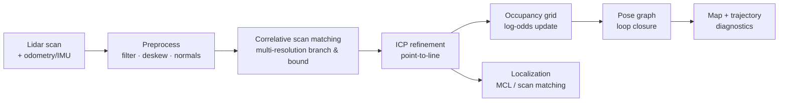

# SLAM design

## Implementation status (2026-10-30)

- ✅ C++17 occupancy grid (5 cm), log-odds updates, chamfer likelihood field.
- ✅ Per-beam scan deskew from the odometry/IMU twist.
- ✅ Coarse/fine correlative scan matching with a motion prior.
- ✅ pybind11 bindings + Python `SlamPipeline`, map export (base64 occupancy).
- ✅ Live dashboard: occupancy map, SLAM ghost pose/trail, ATE, scan time.
- ✅ Benchmark: 2.89 cm mean ATE, 5.27 cm max, 14.2 ms mean / 18.9 ms p95
  (8 s, 81 scans, low-noise odometry).
- ✅ SE(2) pose graph with keyframes, sequential edges and a tested optimizer.
- ✅ 400-particle MCL on the occupancy map, with ESS/spread diagnostics and a
  runtime on/off switch.
- ✅ Global MCL relocalization: scatter particles over free map cells and
  relocalize from the scan. Manual and stuck-triggered; no ground truth.
  **Off by default**: on the symmetric peanut track it can converge to the
  wrong place; it is a kidnap-recovery tool, not a per-lap fix.
- ✅ Dashboard debug layers: map, SLAM, MCL, particles, odometry, GT trail.
- ⏳ Reliable loop-closure detection. **Disabled**: scan-only place recognition
  produced false positives on repetitive pipe walls. No forced start-pose reset.
- ⏳ MCL global relocalization / kidnapped-robot recovery.
- ⏳ Pi benchmark.

**MCL benchmark:** 12 s pure-pursuit run with drifting odometry: SLAM ATE
22.6 cm mean, MCL ATE 22.0 cm mean, MCL max 41.1 cm, ESS 281/400, spread
0.20 m. See [`experiments/EXP-0003-mcl.md`](experiments/EXP-0003-mcl.md).
MCL tracks the map but cannot correct map drift; the map is still the limiting
factor.

**Five-lap sensor-only result:** with a frozen one-lap map (8.3 cm seam), MCL
completes 5/5 laps at **0.9 m/s**, 134.08 s total, MCL ATE 24.7 cm mean /
54.0 cm max, global relocalization off. At 1.2 m/s it still sticks near the seam.
See [`experiments/EXP-0005-map-and-race.md`](experiments/EXP-0005-map-and-race.md).

**Honest status:** the front-end tracks locally but drifts under realistic wheel
odometry. The pose graph is ready; the missing piece is a trustworthy place
recognition front-end (Scan Context, submap descriptors, or a visible
start-line/landmark sensor). Without it, loop closure is not claimed.

See [`experiments/EXP-0002-slam-frontend.md`](experiments/EXP-0002-slam-frontend.md).

## 1. Scope

A from-scratch 2D lidar SLAM pipeline for an indoor track with:

- a spinning 2D lidar (LD06-class, 720 beams, 10 Hz);
- noisy wheel odometry and IMU;
- motion distortion inside each scan;
- dropouts and outliers;
- a loop-shaped track, so loop closure matters.

The output is a pose estimate, an occupancy map, and diagnostics for evaluation
and visualization. The production path is C++17; a Python reference implementation
exists for tests and teaching.

## 2. Pipeline



### 2.1 Preprocessing and deskew

A scan is captured over `T_scan = 0.1 s`. Each point `i` has a timestamp
`t_i = t_start + i/N · T_scan`. The pose at `t_i` is interpolated from
odometry/IMU. The point is transformed into the scan-start frame:

```text
p_start = T_start^-1 · T(t_i) · p_i
```

The deskewed cloud is used for matching; the raw cloud is kept for visualization
and for testing the deskew stage. If IMU/odometry is unavailable, the pipeline can
fall back to a constant-velocity assumption and report degraded confidence.

### 2.2 Correlative scan matching

Given a likelihood field `L(x, y)` built from the occupancy grid, find:

```text
argmax_{Δx, Δy, Δθ} Σ_i L(T(Δ) · p_i)
```

The search is multi-resolution branch-and-bound:

- coarse resolution (e.g., 10 cm / 2°) computes an upper bound;
- promising branches are refined at 5 cm / 1° and 2.5 cm / 0.5°;
- the score surface gives an initial covariance estimate.

This is robust to local minima and fast enough for 10 Hz.

### 2.3 ICP refinement

Point-to-line ICP minimizes:

```text
E(T) = Σ_i ρ( n_i · (T p_i - q_i) )²
```

with robust kernel `ρ` (Huber/Cauchy), correspondence gating and a maximum
iteration count. The Hessian at convergence gives the pose covariance. Outliers
from dropouts and moving objects are rejected.

### 2.4 Occupancy grid

Each cell stores log-odds `l`:

```text
l_t = l_{t-1} + log(p_free) - log(p_occ)   # along the ray
l_t = l_{t-1} + log(p_occ) - log(p_free)   # at the hit
```

with clamping to avoid saturation. Bresenham ray casting marks free cells; the hit
cell is marked occupied. The grid also provides:

- a distance transform / likelihood field for matching;
- map serialization (PNG/JSON/NPZ);
- map quality metrics (IoU against ground truth).

Default resolution: 2.5 cm (configurable), covering 15 × 8 m.

### 2.5 Pose graph and loop closure

Nodes are SE(2) poses; edges are odometry constraints and loop-closure constraints.
Residuals:

```text
r_ij = log( T_i^-1 · T_j · Z_ij^-1 )
```

Optimization is robust Gauss–Newton on the SE(2) manifold with a Huber kernel.
Loop closures are proposed by spatial proximity + local-submap scan matching.
The pose graph is implemented and unit-tested. The automatic detector is
currently disabled because repetitive pipe walls caused false positives; a
trustworthy descriptor (Scan Context) or visible landmark is required before it
is re-enabled.

### 2.6 Localization

Two modes:

- **Scan matching against the map** for local tracking;
- **MCL** with 400 particles for map-based localization.

MCL implementation:

- initialized around the current SLAM pose (local localization);
- particles propagated with the odometry increment + noise;
- weights from the occupancy likelihood field;
- low-variance resampling when ESS < 200;
- weighted mean pose and particle spread exported to the dashboard;
- runtime on/off switch and reset command.

Global relocalization is implemented: particles are spread over free map cells,
scored against the scan, resampled for four rounds, and the mean pose is used.
It is triggered manually or when the stuck recovery fires; it does not run
automatically on every confidence dip. It still cannot correct a distorted map.

## 3. C++ API

```cpp
namespace awake_slam {

struct Pose2 { double x, y, theta; };
struct Scan { std::vector<float> ranges; std::vector<float> angles; double t_start; };
struct Odometry { Pose2 pose; double t; };

struct Diagnostics {
  double match_score;
  int inliers;
  Eigen::Matrix3d covariance;
  bool loop_closure;
  double preprocess_ms, match_ms, icp_ms, map_ms, total_ms;
};

class SlamPipeline {
 public:
  SlamPipeline(const Config&);
  SlamResult process(const Scan&, const Odometry&);
  OccupancyGrid map() const;
  Diagnostics diagnostics() const;
  void save_map(const std::string& path) const;
};

}  // namespace awake_slam
```

The pybind11 module exposes NumPy-compatible arrays and a `SlamPipeline` class.
Python calls it once per scan; no per-point Python overhead.

## 4. Performance targets

| Metric | Target | Current |
|---|---|---|
| Scan processing (720 beams, desktop) | <20 ms | 14.2 ms mean / 18.9 ms p95 |
| Scan processing (360 beams, Pi later) | <50 ms | not benchmarked |
| Map update | <5 ms | included above |
| Loop closure (when triggered) | <50 ms | not implemented |
| Memory | <100 MB for the track map | ~48k cells |

Techniques:

- multi-resolution search instead of brute force;
- precomputed likelihood field;
- correspondence gating and early exit;
- Eigen fixed-size matrices for SE(2);
- optional OpenMP for scan likelihood evaluation;
- no GPU dependency.

## 5. Evaluation

Ground truth is available from the simulator but never given to SLAM. Metrics:

- **ATE** — absolute trajectory error after alignment.
- **RPE** — relative pose error over fixed intervals.
- **Map IoU** — occupied/free cell agreement vs ground-truth track.
- **Loop closure** — precision/recall of accepted closures.
- **Runtime** — per-stage and total.
- **Robustness** — ATE/lap completion under `realistic` and `harsh` presets.

Evaluation runs are recorded and plotted in `docs/experiments/`.

## 6. Racing integration

| Mode | Description |
|---|---|
| `mapping` | Low-speed exploration lap; build map, centreline and racing line |
| `race_mcl` | Localize on the prior map with MCL/scan matching; race |
| `online_slam` | SLAM while racing, for unknown-track/no-practice scenarios |

The strategy lab compares lap times and crash rates across these modes. The
expected result is that mapping first is faster and safer when practice time is
available.

## 7. Raspberry Pi port (deferred)

The C++ core is designed to be portable:

- C++17 + Eigen + standard library only;
- no CUDA, no ROS, no desktop GUI;
- Python bindings via pybind11;
- ARM build instructions will be added when the port starts;
- performance must be benchmarked on the Pi, not assumed.

The Python controller and map export are already hardware-agnostic.

## 8. Visualization

The dashboard shows:

- raw and deskewed scans;
- occupancy grid and likelihood field;
- matched scan overlay;
- ground-truth, odometry and SLAM trajectories;
- covariance ellipses and particle cloud;
- pose graph nodes/edges and loop closures;
- per-stage timing and match score;
- map delta and coverage.

## 9. Failure modes to test

- lidar mounted above the 16 cm walls (no wall returns);
- 50% dropout and dead beams;
- 100 ms latency;
- high wheel slip;
- symmetric/feature-poor sections;
- loop closure false positives;
- kidnapped robot (global relocalization).
