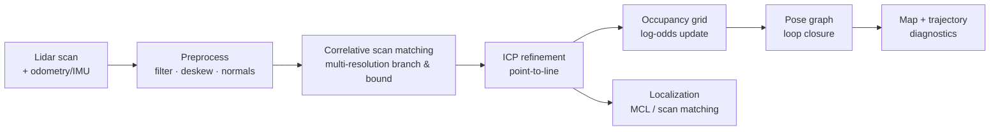

# SLAM design

## Implementation status (2026-10-30)

- ✅ C++17 occupancy grid (5 cm), log-odds updates, chamfer likelihood field.
- ✅ Per-beam scan deskew from the odometry/IMU twist.
- ✅ Coarse/fine correlative scan matching with a motion prior.
- ✅ pybind11 bindings + Python `SlamPipeline`, map export (base64 occupancy).
- ✅ Live dashboard: occupancy map, SLAM ghost pose/trail, ATE, scan time.
- ✅ Benchmark: 2.89 cm mean ATE, 5.27 cm max, 14.2 ms mean / 18.9 ms p95
  (8 s, 81 scans, `slam-bench`).
- ⏳ Pose graph + loop closure (M3b).
- ⏳ MCL / global relocalization (M3b).
- ⏳ Real-log replay and Pi benchmark (later).

See [`experiments/EXP-0002-slam-frontend.md`](experiments/EXP-0002-slam-frontend.md).

## 1. Scope

A from-scratch 2D lidar SLAM pipeline for an indoor track with:

- a spinning 2D lidar (LD06-class, 720 beams, 10 Hz);
- noisy wheel odometry and IMU;
- motion distortion inside each scan;
- dropouts and outliers;
- a loop-shaped track, so loop closure matters.

The output is a pose estimate, an occupancy map, and diagnostics for evaluation
and visualization. The production path is C++17; a Python reference implementation
exists for tests and teaching.

## 2. Pipeline



### 2.1 Preprocessing and deskew

A scan is captured over `T_scan = 0.1 s`. Each point `i` has a timestamp
`t_i = t_start + i/N · T_scan`. The pose at `t_i` is interpolated from
odometry/IMU. The point is transformed into the scan-start frame:

```text
p_start = T_start^-1 · T(t_i) · p_i
```

The deskewed cloud is used for matching; the raw cloud is kept for visualization
and for testing the deskew stage. If IMU/odometry is unavailable, the pipeline can
fall back to a constant-velocity assumption and report degraded confidence.

### 2.2 Correlative scan matching

Given a likelihood field `L(x, y)` built from the occupancy grid, find:

```text
argmax_{Δx, Δy, Δθ} Σ_i L(T(Δ) · p_i)
```

The search is multi-resolution branch-and-bound:

- coarse resolution (e.g., 10 cm / 2°) computes an upper bound;
- promising branches are refined at 5 cm / 1° and 2.5 cm / 0.5°;
- the score surface gives an initial covariance estimate.

This is robust to local minima and fast enough for 10 Hz.

### 2.3 ICP refinement

Point-to-line ICP minimizes:

```text
E(T) = Σ_i ρ( n_i · (T p_i - q_i) )²
```

with robust kernel `ρ` (Huber/Cauchy), correspondence gating and a maximum
iteration count. The Hessian at convergence gives the pose covariance. Outliers
from dropouts and moving objects are rejected.

### 2.4 Occupancy grid

Each cell stores log-odds `l`:

```text
l_t = l_{t-1} + log(p_free) - log(p_occ)   # along the ray
l_t = l_{t-1} + log(p_occ) - log(p_free)   # at the hit
```

with clamping to avoid saturation. Bresenham ray casting marks free cells; the hit
cell is marked occupied. The grid also provides:

- a distance transform / likelihood field for matching;
- map serialization (PNG/JSON/NPZ);
- map quality metrics (IoU against ground truth).

Default resolution: 2.5 cm (configurable), covering 15 × 8 m.

### 2.5 Pose graph and loop closure

Nodes are SE(2) poses; edges are odometry constraints and loop-closure constraints.
Residuals:

```text
r_ij = log( T_i^-1 · T_j · Z_ij^-1 )
```

Optimization is robust Gauss–Newton on the SE(2) manifold with a Huber kernel.
Loop closures are proposed by spatial proximity + scan matching, then accepted by
a score/inlier threshold. The dashboard shows loop-closure edges and the pose graph.

### 2.6 Localization

Two modes:

- **Scan matching against the map** for local tracking;
- **Monte Carlo localization (MCL)** with a particle filter for global
  relocalization and recovery.

Particles are propagated with odometry + IMU, weighted by the likelihood field,
and resampled with low-variance sampling. Covariance and particle cloud are
exported for visualization.

## 3. C++ API

```cpp
namespace awake_slam {

struct Pose2 { double x, y, theta; };
struct Scan { std::vector<float> ranges; std::vector<float> angles; double t_start; };
struct Odometry { Pose2 pose; double t; };

struct Diagnostics {
  double match_score;
  int inliers;
  Eigen::Matrix3d covariance;
  bool loop_closure;
  double preprocess_ms, match_ms, icp_ms, map_ms, total_ms;
};

class SlamPipeline {
 public:
  SlamPipeline(const Config&);
  SlamResult process(const Scan&, const Odometry&);
  OccupancyGrid map() const;
  Diagnostics diagnostics() const;
  void save_map(const std::string& path) const;
};

}  // namespace awake_slam
```

The pybind11 module exposes NumPy-compatible arrays and a `SlamPipeline` class.
Python calls it once per scan; no per-point Python overhead.

## 4. Performance targets

| Metric | Target | Current |
|---|---|---|
| Scan processing (720 beams, desktop) | <20 ms | 14.2 ms mean / 18.9 ms p95 |
| Scan processing (360 beams, Pi later) | <50 ms | not benchmarked |
| Map update | <5 ms | included above |
| Loop closure (when triggered) | <50 ms | not implemented |
| Memory | <100 MB for the track map | ~48k cells |

Techniques:

- multi-resolution search instead of brute force;
- precomputed likelihood field;
- correspondence gating and early exit;
- Eigen fixed-size matrices for SE(2);
- optional OpenMP for scan likelihood evaluation;
- no GPU dependency.

## 5. Evaluation

Ground truth is available from the simulator but never given to SLAM. Metrics:

- **ATE** — absolute trajectory error after alignment.
- **RPE** — relative pose error over fixed intervals.
- **Map IoU** — occupied/free cell agreement vs ground-truth track.
- **Loop closure** — precision/recall of accepted closures.
- **Runtime** — per-stage and total.
- **Robustness** — ATE/lap completion under `realistic` and `harsh` presets.

Evaluation runs are recorded and plotted in `docs/experiments/`.

## 6. Racing integration

| Mode | Description |
|---|---|
| `mapping` | Low-speed exploration lap; build map, centreline and racing line |
| `race_mcl` | Localize on the prior map with MCL/scan matching; race |
| `online_slam` | SLAM while racing, for unknown-track/no-practice scenarios |
| `replay` | Process recorded real/sim lidar logs offline |

The strategy lab compares lap times and crash rates across these modes. The
expected result is that mapping first is faster and safer when practice time is
available.

## 7. Raspberry Pi port (deferred)

The C++ core is designed to be portable:

- C++17 + Eigen + standard library only;
- no CUDA, no ROS, no desktop GUI;
- Python bindings via pybind11;
- ARM build instructions will be added when the port starts;
- performance must be benchmarked on the Pi, not assumed.

The Python controller and map export are already hardware-agnostic.

## 8. Visualization

The dashboard shows:

- raw and deskewed scans;
- occupancy grid and likelihood field;
- matched scan overlay;
- ground-truth, odometry and SLAM trajectories;
- covariance ellipses and particle cloud;
- pose graph nodes/edges and loop closures;
- per-stage timing and match score;
- map delta and coverage.

## 9. Failure modes to test

- lidar mounted above the 16 cm walls (no wall returns);
- 50% dropout and dead beams;
- 100 ms latency;
- high wheel slip;
- symmetric/feature-poor sections;
- loop closure false positives;
- kidnapped robot (global relocalization).
