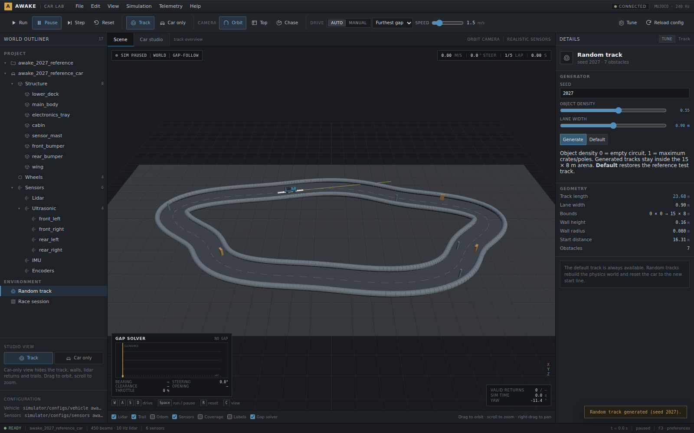
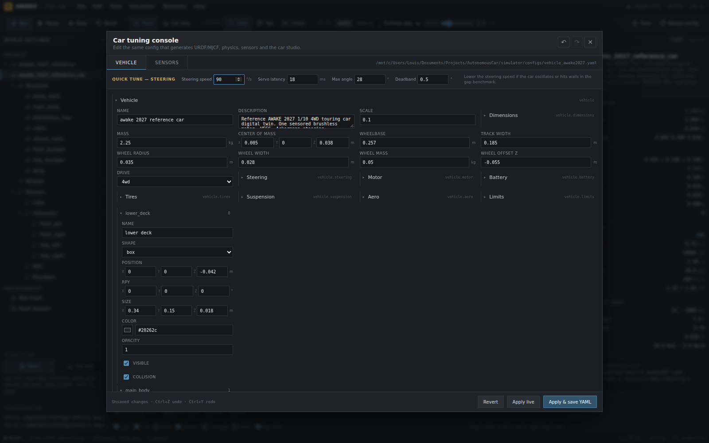
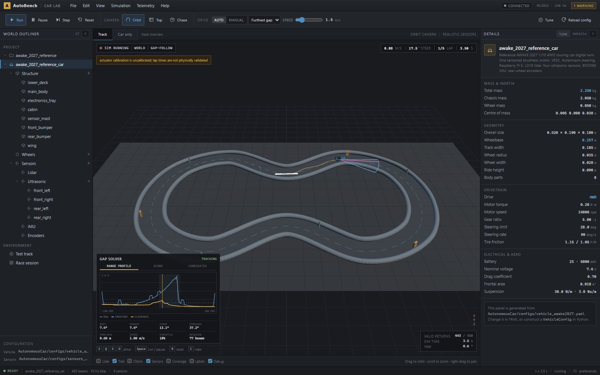
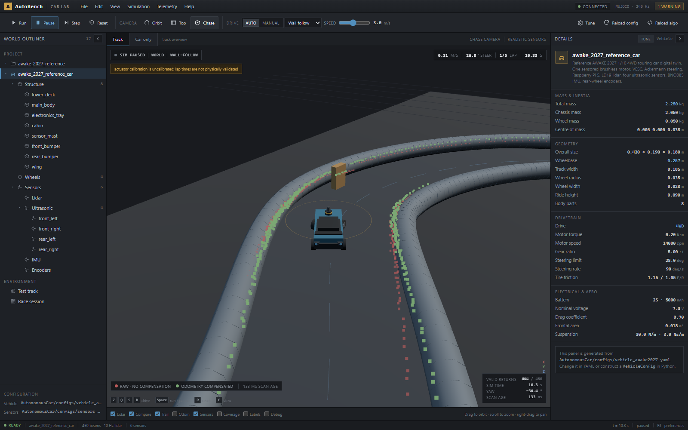
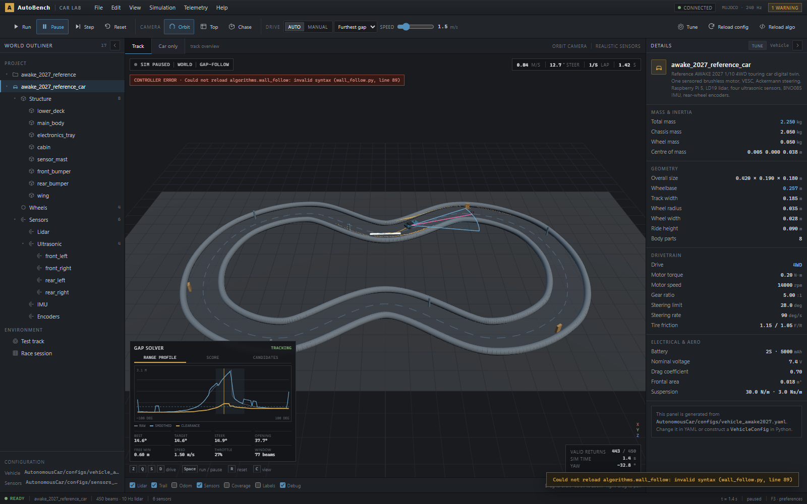
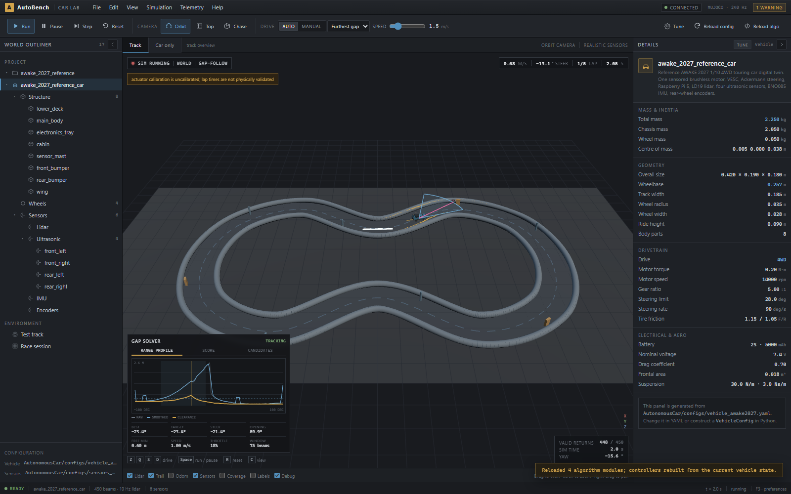

# Dashboard

## Views

### Track

Live 3D view of the car, track surface, pipe walls, obstacles, lidar returns,
path trail and optional odometry trail. The viewport header shows run state,
controller, lap and timing. Manual driving uses Z/Q/S/D.

### Car studio

The **Car only** view hides track surface, walls, obstacles, lidar returns and
trails. It renders the vehicle, body parts, wheels and sensor mounts from the
same JSON payload used by the rest of the dashboard. Optional layers show sensor
coverage and labels.

The studio is intended for inspecting mass/geometry/sensor changes without the
track distracting from the car.

## Outliner and details

The left outliner exposes scenario, vehicle, structure parts, wheels, sensors,
track and race session. Clicking a node fills the right details panel with the
live configuration values. Sensor details include body-frame position, RPY,
height, range and model characteristics.

Both side panels are retractable. Use the chevron in a panel heading to collapse
it to a narrow rail, and click the rail to restore it. The workspace expands as a
panel collapses, giving the viewport more room. The single Track / Car only
switch lives in the viewport header; there are no duplicate copies in the
toolbar or outliner.

### Controller debug

Controllers may expose an optional `debug_frame()` returning a serialisable
`DebugFrame` from `algorithms/debug.py`. The dashboard renders its readouts,
plots, candidate tables and spatial overlays without importing controller-specific
classes. The **Debug** layer toggle hides or shows the viewport overlay; manual
driving hides the panel.

Adding a controller means adding it to `algorithms/registry.py` and, if useful,
returning a `DebugFrame`. The generic renderer then works immediately. See
`algorithms/template.py` for a minimal readout example. For a fully custom
layout, register a React component in
`dashboard/web/src/DebugRenderers.tsx`; the server and transport do not change.
The frame's `meta` object carries controller-specific values for that case.

### Gap-solver debug

When the gap-follow controller is active, the debug dock shows three views:

- **Range profile**: raw, smoothed and clearance distances against bearing, the
  free-space threshold, the selected bearing and the detected opening.
- **Score**: the total score and centering penalty. The score is
  `clearance - centering_weight * |bearing|`.
- **Candidates**: the top scored beams with bearing, range, clearance, score and
  whether they belong to the opening. The selected row is highlighted.

The viewport shows the chosen opening as a restrained fan, the selected bearing,
and the three best-separated candidate beams. Readouts show the winning bearing,
clamped target, applied steering, opening width, free-space threshold, target
speed, throttle and clearance window. If the best beam is outside the steering
limit, the winning and clamped target bearings are drawn separately.

The **Debug** layer toggle hides it.

### Tuning console and track generator

The **Tune** action opens a modal that edits the raw vehicle and sensor configs.
It supports `Ctrl+Z`/`Ctrl+Y` undo/redo, live apply and save-to-YAML. The steering
quick-tune strip exposes `rate_deg_s`, latency, max angle and deadband.

The **Test track** details panel generates random smooth tracks with seed, lane
width, object density and object size. Object size scales the nominal
crate/pole footprint; per-object jitter mixes small and larger obstacles while
keeping each footprint inside the lane. **Default** restores the reference test
track.

## Toolbar

- Run, pause, step and reset.
- Orbit, top and chase cameras; turntable in car studio.
- Auto/manual drive, demo controller and speed limit.
- Tune, reload config and reload algorithms.
- Layer toggles: lidar, compare, trail, odometry, sensors, coverage, labels,
  debug.

The **Compare** layer switches the lidar view from “raw scan at its measurement
pose” to two clouds at the live car pose:

- red: the old scan interpreted as if it were measured at the current car pose
  (no motion compensation);
- green: the same scan warped into the current lidar frame using the dashboard’s
  history of estimated odometry.

Both clouds use the live true car pose as the world anchor, so the raw cloud
drifts off the walls while the compensated cloud stays on them. The legend and
the **scan age** readout show how old the measurement is. This is a display-only
comparison; the controller’s actual interface is
`Observation.compensated_lidar` / `Observation.lidar_current`.

**Reload config** reloads the scenario/vehicle/sensor YAML and rebuilds the
physics, sensors, estimator and simulation. It pauses the run. **Reload algo**
re-imports `algorithms/*.py` and the controller registry, rebuilds controller
instances and keeps the current simulation, track and lap state. The new
controller takes over on the next tick; use **Reset** for a fresh start. The
reload covers `algorithms/*.py`; changes under `onboard/` or `simulator/` still
require a server restart.

Import failures and controller exceptions are non-fatal. The run pauses, a
persistent red **controller error** strip shows the exception, and the server
keeps running. The previous controller instances stay alive after a failed
reload, so you can fix the file and click **Reload algo** again.

The Track / Car only view switch sits in the viewport header, next to the camera
and sensor-realism readout.

Keyboard shortcuts: `Space` run/pause, `R` reset, `C` view, `1`/`2`/`3` camera,
`T` turntable, `Z/Q/S/D` manual drive (WASD also works).

## Design language

The UI is a flat desktop engineering application, closer to an Unreal/CAE tool
than a consumer web dashboard:

- square panels, 1 px separators, dense type;
- neutral blue-grey chrome with a restrained amber accent;
- monospaced numeric values;
- no decorative gradients, glowing cards or oversized rounded containers.

## Protocol

REST: `/api/health`, `/api/status`, `/api/car`, `/api/car/mjcf`, `/api/track`, `/api/config`.

WebSocket `/ws/telemetry`:

- server: `hello`, `state`, `scan`, `config.result`, `track.result`,
  `controller.result`;
- client: `run.start`, `run.pause`, `run.reset`, `run.step`,
  `run.set_speed`, `control.mode`, `control.controller`, `drive.command`,
  `config.reload`, `config.apply`, `controller.reload`, `track.generate`,
  `track.default`, `ping`.

`hello.controllers` advertises the registry. `state.debug` carries the active
controller's optional `DebugFrame`; it is `null` in manual mode or when the
controller has no debug view.

The simulator runs MuJoCo and the dashboard displays `MUJOCO` in the title bar.

The backend throttles state to 30 Hz and forwards new lidar scans at the sensor
rate. It drops stale frames rather than delaying physics.
